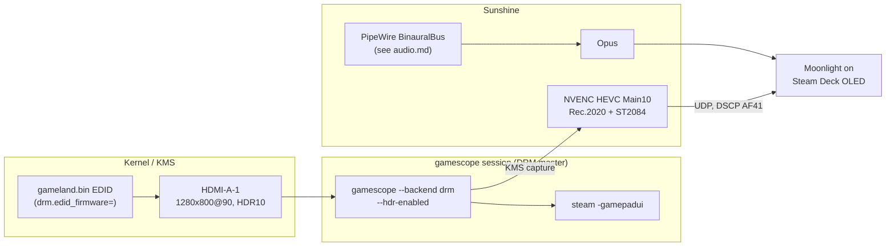

# Streaming a headless NVIDIA box to a Steam Deck

How Gameland streams games: a headless Arch box (RTX 3080 10GB, nvidia-open
595.71.05, no monitor, no dummy plug) running gamescope on bare DRM with a
kernel-injected Steam Deck EDID, captured by Sunshine over KMS, decoded by
Moonlight on a Steam Deck OLED — 1280×800@90, HDR10, HEVC 10-bit.

It did not start out this way. This doc is the story of why each piece is
there, because every piece replaced something that looked simpler and didn't
work.



## 1. Why not Steam Remote Play: the Linux Vulkan-capture bug

The first iteration of this box used Steam Remote Play — no extra software,
native Deck integration. It produced a maddening split: **Hogwarts Legacy
streamed at a flat 120 fps at 35–40% GPU, while Witchfire was stuck at
20–30 fps** on the same host, same session, same encoder.

Steam's own frame-timing log (`~/.local/share/Steam/logs/streaming_log.txt`,
grep `Slow framerate`) gave the diagnosis:

```
CaptureDescriptionID = "Desktop OpenGL NV12 + NVENC HEVC"
Slow framerate: game 0.00 ms, capture ~2 ms, encode 30–49 ms  (blamed: encode)
```

Two details matter:

- `game 0.00 ms` — the GPU renders the frame essentially instantly. The host
  is not slow.
- `CaptureDescriptionID = "Desktop OpenGL …"` — Steam is using its
  **desktop-grab fallback**, not the game-capture fast path. A healthy
  session reports a *game* capture description. The 30–49 ms charged to
  "encode" is the desktop readback + copy + NVENC submit serialised on one
  path, not a real 30 ms encode (the same NVENC does 120 fps for Hogwarts).

This is a known, years-old, unfixed Valve defect: **Steam Remote Play on
Linux does not fast-capture Vulkan-presenting games** (native Vulkan, and
DX→Vulkan via Proton/VKD3D on the affected path). They fall back to desktop
capture and pin at ~20–25 fps regardless of render speed. Tracked in
ValveSoftware/steam-for-linux as
[#11053](https://github.com/ValveSoftware/steam-for-linux/issues/11053)
(the canonical report — the numbers match this box almost exactly), with
[#5591](https://github.com/ValveSoftware/steam-for-linux/issues/5591),
[#6738](https://github.com/ValveSoftware/steam-for-linux/issues/6738) and
[#9332](https://github.com/ValveSoftware/steam-for-linux/issues/9332) as
related/duplicate reports. There is no host-side setting that fixes it.

So: Witchfire (native Vulkan, UE5) hit the broken path; Hogwarts (VKD3D, but
presenting in a way Steam can fast-capture) didn't. Every host-tuning lever
was tested and exonerated — OC, P-states, PowerMizer registry knobs, bitrate
(a real but lossy mitigation), MangoHud's implicit Vulkan layer. The
community-correct fix is GPU-side capture: **Sunshine + Moonlight**. That is
why Sunshine exists on this box.

## 2. The headless EDID problem on nvidia-open

Sunshine needs something to capture, and modern Sunshine on this stack means
KMS capture of a real DRM plane. A headless NVIDIA box has no display, so
you have to convince the kernel there is one. On `nvidia-open` this is much
narrower than the internet suggests:

- **HDMI dummy plugs don't work.** `nvidia-modeset` cannot read a dummy
  plug's EDID over DDC at the KMS layer. (The legacy Xorg escape hatch —
  `ModeValidation "NoEdidModes, AllowNonEdidModes…"` + hand-written
  modelines — worked, but dies with Xorg, and the whole point was to drop
  the Xorg/desktop-grab stack.)
- **Invalid injected EDIDs are silently ignored.** `nvidia-modeset`
  validates `drm.edid_firmware` payloads; a hand-rolled or truncated EDID is
  dropped without any error and the connector stays modeless.
- **`/sys/class/drm/*/edid` is always empty on NVIDIA** — even when
  injection succeeded. Do not use it to verify. Check the `modes` file
  instead:

  ```
  $ cat /sys/class/drm/card*-HDMI-A-1/modes
  1280x800
  ```

  Modes present = EDID accepted. Empty `edid` file means nothing.

### The working recipe

1. **A real, valid EDID.** This box injects an actual Steam Deck panel EDID
   (256 bytes, includes HDR10/ST2084 metadata — exactly the display we're
   pretending to be), from
   [Bloodhundur/steamdeckedid](https://github.com/Bloodhundur/steamdeckedid),
   vendored at [`host/usr/lib/firmware/edid/steamdeck.bin`](../host/usr/lib/firmware/edid/steamdeck.bin).
   The box injects [`gameland.bin`](../host/usr/lib/firmware/edid/gameland.bin),
   derived from it by [`scripts/gen-edid.py`](../scripts/gen-edid.py) to add
   1920x1200 at 60/90/120 Hz (§6).
2. **Kernel-inject it and force the connector on** — from
   [`host/boot/loader/entries/arch.conf`](../host/boot/loader/entries/arch.conf):

   ```
   nvidia_drm.modeset=1 nvidia_drm.fbdev=1
   drm.edid_firmware=HDMI-A-1:edid/gameland.bin video=HDMI-A-1:e
   ```

   The EDID lives under `/usr/lib/firmware`, so rebuild the initramfs
   (`mkinitcpio -P`) after placing it.
3. **gamescope drives the connector directly** as DRM master —
   [`host/usr/local/bin/gamescope-headless.sh`](../host/usr/local/bin/gamescope-headless.sh):

   ```
   gamescope --backend drm --prefer-output HDMI-A-1 \
             -W 1280 -H 800 -r 90 --hdr-enabled -e -- steam -gamepadui
   ```

4. **Sunshine captures over KMS** with HDR intact: Rec.2020 primaries +
   SMPTE ST2084 (PQ) transfer, encoded as HEVC Main10 by NVENC. The Deck
   OLED displays real HDR at the other end.

Historical note: gamescope's DRM backend originally SIGSEGV'd on this stack
and was written off. The crash was downstream of the modeless connector —
once a valid EDID is injected, gamescope-DRM runs fine. If gamescope dies
instantly on a headless NVIDIA box, check `modes` before blaming gamescope.

## 3. The DRM-master ordering invariant

There is exactly one DRM master. gamescope must hold it **before** Sunshine
attaches its KMS capture. Get the order wrong and Sunshine spams
`drmModeAtomicCommit: Permission denied` while the client shows a black
stream with working audio — a uniquely confusing failure.

The ordering is enforced in systemd, not in anyone's memory:

- [`sunshine.service`](../host/etc/systemd/system/sunshine.service) has
  `BindsTo=gamescope-headless.service` + `After=gamescope-headless.service`,
  so Sunshine cannot outlive or predate the compositor.
- A [drop-in `ExecStartPre`](../host/etc/systemd/system/sunshine.service.d/10-wait-gamescope.conf)
  wait-loop holds Sunshine until `gamescope-wl` and `steam` processes
  actually exist (unit ordering alone races against gamescope's startup).

**Restart rule** (also what the mode-switch agent does): stop `sunshine` →
restart `gamescope-headless` → start `sunshine`. Never bounce gamescope
under a live Sunshine.

## 4. Hard limits on this hardware

Things that are not bugs and not fixable; documented so nobody chases them
again:

- **No AV1.** GA102/Ampere has no AV1 encoder; `av1_nvenc` reports "No
  capable devices found". Moonlight's "host doesn't support AV1" message is
  expected and permanent on this GPU. HEVC 8/10-bit works fine.
- **P2 pstate under any CUDA/NVENC context, by design.** Consumer GeForce
  drops to P2 whenever a CUDA or NVENC context exists; memory clock is
  capped at 9251 MHz (P0 would be 9501). `nvidia-smi -lmc` is
  accepted-but-ignored. Cost is ~3% memory throughput — irrelevant to
  streaming. See the [Xid 79 postmortem](lessons/xid79-gddr6x-heat-soak.md)
  for the rest of the clock story.
- **The eglcore teardown segfault is cosmetic.** Stopping the gamescope
  session logs a SIGSEGV (status=11) in `libnvidia-eglcore` during
  teardown, after the last frame has been delivered. The unit runs
  `Restart=no`; the agent's flip path tolerates it. Annoying in the
  journal, harmless in practice.

## 5. What runs today

| Piece | Setting | Where |
|---|---|---|
| Display | HDMI-A-1, 1280×800@90, HDR10, kernel-injected Deck EDID | [`host/boot/loader/entries/arch.conf`](../host/boot/loader/entries/arch.conf) |
| Compositor | gamescope DRM backend, `--hdr-enabled`, launches `steam -gamepadui` | [`host/usr/local/bin/gamescope-headless.sh`](../host/usr/local/bin/gamescope-headless.sh) |
| Session unit | tty8 login session via `PAMName=login`, caps dropped (Steam bwrap) | [`host/etc/systemd/system/gamescope-headless.service`](../host/etc/systemd/system/gamescope-headless.service) + [drop-ins](../host/etc/systemd/system/gamescope-headless.service.d/) |
| Capture/encode | Sunshine `capture = kms`, `encoder = nvenc`, HEVC Main10 HDR | [`host/home/gamer/.config/sunshine/sunshine.conf`](../host/home/gamer/.config/sunshine/sunshine.conf) |
| Bitrate | no server cap (client sets it), `fec_percentage = 20` | same |
| Input | `gamepad = xone` (Xbox One pad emulation — `ds5` was trialled for gyro but retired); keyboard/mouse disabled | same |
| Audio | Sunshine captures `BinauralBus` (host-side binaural; Moonlight client set to STEREO) | [audio.md](audio.md) |
| QoS | DSCP AF41 on Sunshine UDP egress (47998–48010) | [`host/etc/nftables.d/sunshine-qos.nft`](../host/etc/nftables.d/sunshine-qos.nft) |
| Disconnect | watchdog kills the running game on `CLIENT DISCONNECTED` (+20 s retry) | [`host/etc/systemd/system/sunshine-disconnect-watchdog.service`](../host/etc/systemd/system/sunshine-disconnect-watchdog.service) |
| GPU mode | `gpu-profile gaming` (compute_mode=DEFAULT — required) at session start | [`host/usr/local/sbin/gpu-profile`](../host/usr/local/sbin/gpu-profile) via [`gpu-gaming.service`](../host/etc/systemd/system/gpu-gaming.service) |

Unit chain: `gpu-gaming.service` → `gamescope-headless.service` →
`sunshine.service` (BindsTo). The whole stack is started and stopped by the
mode-switch agent — see [architecture.md](architecture.md).

Remaining gotchas baked into that config, learned the hard way:

- **`max_bitrate = 50000` is a ceiling, not a target.** Without it, an
  IDR-keyframe feedback spiral can inflate actual throughput to 150+ Mbps
  over a 30 Mbps client slider and shred the Wi-Fi link. FEC adds parity
  overhead on top — currently dialled down to 5% on a clean link (it was
  run as high as 20% while chasing Wi-Fi loss).
- **`csrf_allowed_origins` must be a plain comma-separated list.** A JSON
  array is silently rejected — the web UI just stops accepting logins with
  no error.
- **NVENC needs `compute_mode = DEFAULT`.** If the box is left in
  EXCLUSIVE_PROCESS (compute mode), NVENC can't allocate a context next to
  Steam and Sunshine silently falls back to software libx264. That is what
  `gpu-gaming.service` exists to prevent, and why the agent never flips to
  compute while a stream is live.
- No credentials live in `sunshine.conf`; pairing state and web-UI creds
  are in `sunshine_state.json`, which is deliberately never synced into
  this repo.

## 6. Multi-resolution clients

The output mode follows each Moonlight client automatically, with no
restart. On every connection Sunshine's `global_prep_cmd` runs
[`stream-mode`](../host/usr/local/bin/stream-mode) with the client's
`SUNSHINE_CLIENT_WIDTH/HEIGHT/FPS`. It picks a mode from gamescope's own list
(`GAMESCOPE_DISPLAY_MODE_LIST_EXTERNAL`), writes it to gamescope's mode file
and sets `GAMESCOPE_DISPLAY_MODE_NUDGE`, the same live-modeset path Steam
uses for external displays on SteamOS. Both are X properties on gamescope's
Xwayland, reachable from Sunshine's sandbox through the abstract socket.

Picking rules: the client's exact size if offered, at the lowest refresh at
or above its FPS (else the highest). Otherwise the largest mode that fits
inside the client, preferring the same aspect ratio; Sunshine scales the
rest. `stream-mode --self-test` covers the rules; it never fails a
connection, it logs and leaves the mode alone.

This only works because `gamescope-headless.sh` launches without
`-W/-H/-r`: those set gamescope's preferred mode, which overrides the mode
file. The mode file
(`~gamer/.config/gamescope/modes.cfg`, line `Samsung Electric Company
SAMSUNG:WxH@R`) is reset at boot by `tmpfiles.d` to the default,
1920x1200@120 (`DEFAULT_MODE` in `stream-mode`; host/80 verify checks the two
agree). Sunshine's undo command, `stream-mode --default`, returns to it when a
session ends, so the box idles at 1200p and each client switches on connect.

`stream-res` pins a mode instead, for when automatic isn't wanted. It
restarts gamescope + Sunshine with explicit flags (~20 s, Steam session
included), refuses while a client is connected unless `--force`, and
`stream-mode` stands down while a pin exists:

```
stream-res status     # pinned or automatic, live mode
stream-res 1200p      # pin 1920x1200@120
stream-res 1080p      # pin 1920x1080@60
stream-res 2560x1600@60   # pin any WxH[@R] the EDID offers
stream-res deck       # pin 1280x800@90
stream-res auto       # unpin: automatic per client, idle at 1920x1200@120
```

1920x1200 isn't in the Deck EDID. `gameland.bin` reuses three slots for it:
the extension's duplicate 2560x1440@120 DTD becomes 1920x1200@120 (CVT
reduced blanking, 317 MHz), and the 1152x864@75 and 1280x1024@60 standard
timings become 1920x1200@60 and @90. To add a mode, edit
`scripts/gen-edid.py`, rerun it, test with the DRM debugfs
`edid_override` before rebooting, and keep the preferred 1280x800@90 DTD
first.

## 7. Per-game workarounds

| Game | Launch options | Why |
|---|---|---|
| Titanfall 2 | `DISABLE_GAMESCOPE_WSI=1 %command%`, Proton Experimental | gamescope 3.16.31's WSI layer crashes the EA app in `vkGetPhysicalDeviceSurfaceFormats2KHR` (null call, `c0000005 in Unix call`). The game then fails with "Failed to get Origin environment setting: The Origin desktop application is not loaded". Same crash on GE-Proton and Valve Proton; fine on 3.16.28. |

Titanfall 2 campaign: **Continue** can crash on some checkpoints (seen mid
Blood and Rust, inside BT). Restoring the save sets auto-exposure through
`dev/exposure_log_luminance`, a material the game only creates on its first
3D post-processed frame, and the video-backed main menu never draws one, so
client.dll reads a null pointer (`client.dll+0x3664d1`). Matches Windows
reports for that mission. Start the mission from **Mission Select** instead;
fresh level starts work.

`DISABLE_GAMESCOPE_WSI=1` costs only HDR for that game. Drop the workaround
once a gamescope update stops the EA app crashing without it.

The EA in-game overlay is off for Titanfall 2: `user.igoEnabled=false` in the
prefix's `AppData/Local/Electronic Arts/EA Desktop/user_<id>.ini`. Edit it
only while the EA app is closed, and re-add it if the prefix is recreated.
